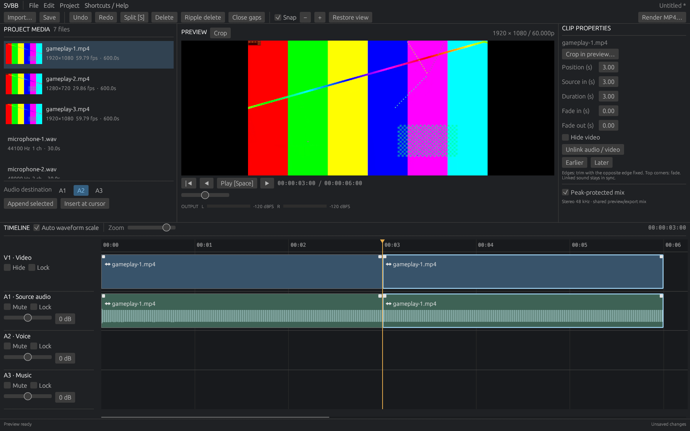

# SonyVegasButBetter (SVBB)

A native, local video editor for cutting gameplay and mixing separate voice
recordings. Rust owns the edit model; FFmpeg and libmpv provide media processing.
No account, telemetry service or network access is needed for editing.

**Early Windows preview.** [Download v0.1.5](https://github.com/MaxHastings/SonyVegasButBetter/releases/tag/v0.1.5) · [Changes](CHANGELOG.md) · [Report a bug](https://github.com/MaxHastings/SonyVegasButBetter/issues/new?template=bug_report.yml)

## Run

1. Download **SVBB-0.1.5-windows-x64-first-run.zip** from the release page.
2. Extract the entire ZIP to a writable folder, such as Documents\SVBB.
3. Double-click **Start SVBB.cmd**. First launch downloads and verifies about
   250 MB of media tools from upstream. Windows 10/11 x64 is required.
4. Edit normally. Later launches work offline; keep the runtime folder beside
   the editor. No administrator access, Rust, or 7-Zip installation is required.

The compiler runtime and an app-local Vulkan loader are included; no separate
Visual C++ or Vulkan installer is required. This preview is unsigned. Setup errors stay visible and are recorded in
`setup.log`; run the launcher again to retry. See [PLAYTEST.md](PLAYTEST.md) for
shortcuts, [TESTING.md](TESTING.md) for coverage and [BUILDING.md](BUILDING.md)
for source builds. macOS/Linux are built in CI; downloadable packages and native
GUI verification are currently Windows only.

To upgrade, extract the new release into a new folder. You can copy the previous
release's `runtime` folder into it to reuse the media tools; the launcher verifies
them before starting. Your saved projects remain compatible.

Playback logs are local in `%LOCALAPPDATA%\SVBB\logs` on Windows, alongside the
app cache on other systems. The latest eight sessions are retained, up to 1 MiB
each. Error dialogs include **Copy error details** and the session log path.
Review logs for personal paths before sharing them; nothing is uploaded automatically.

## Crop and fit an upload limit

Edit the timeline first, then choose **Render MP4 → Fit under a size limit**.
Enter 10 MB or a custom maximum. Video quality and audio bitrate adjust to the
budget; automatic format adjustment can reduce resolution and frame rate as well.
The export preserves the edited mix volume and timing. Auto uses GPU bitrate
encoding when available; CPU two-pass H.264 remains selectable for compression
quality. The finished MP4 is measured before acceptance.
An overrun retries at a lower bitrate; failure/cancellation preserves the destination.
MB is decimal (1,000,000 bytes), including audio and container overhead.

Select a video clip and click **Crop** in Preview. Draw a box, drag its interior
to move it, or drag corners to resize. Match project aspect is the default;
Free allows arbitrary rectangles. Preview result shows the framing before Apply.
Enter applies one undoable change; Escape cancels. Reset crop restores the source.
Every clip has its own crop. A split inherits it, then either piece can be changed
independently. Crops save in the project and affect preview, trimming and export.

The size-limit workflow is inspired by Maxwell's [Shorty](https://github.com/MaxHastings/Shorty),
implemented here in the editor's native export pipeline.

## Workflow

Import multiple recordings with Ctrl+I or OS file drop. Append or drag media onto
the video-only V1 and three audio lanes. Split, trim, reposition,
reorder, ripple-delete and undo. Balance source audio on A1 with its track
gain; match microphone clips to a measured loudness target, adjust gain and fades.
Save an SQLite `.svbb` project, reopen it, and render a validated H.264/AAC MP4.

Video is sequential with no overlapping primary clips. Each audio lane allows
gaps; dragging against a neighbour stops flush automatically. Use another lane
for overlapping recordings. Ctrl+wheel zooms at the mouse, wheel pans, + / −
zoom at the playhead, and F toggles fit / previous view. Shift+F zooms to the selected clip; Alt+Left/Right jumps to adjacent cuts on the selected track. Holding a move or trim at the viewport edge scrolls the timeline. A visible timeline slider
also controls zoom. Source audio appears on its own linked clip. Move, split and trim either partner to edit
both. Unlink in Clip Properties to edit independently.

## Limits

One video lane, three audio lanes, straight cuts, SDR output. No titles, visual
effects, layering, denoising or plugin hosting. The tested output baseline is
1080p60; preview displays a 960×540 image decoded on demand from originals. A 32 MiB frame cache and three warm source decoders speed up revisiting shots. Visual requests bypass audio loading; obsolete requests cannot replace the current preview.
Long files do not need video or PCM copies before editing. Waveforms fill in while
indexing runs in the background. Click a clip once to position the playhead, then
S to split. Drag edges to trim with live source preview; drag top corners to fade.
Auto export tests hardware encoders and falls back to CPU. Render progress shows an
estimated remaining time and the encoder actually used.
Local files only; media with indeterminate duration
or undecodable streams is rejected with an error.

Runtime import checks probe streams and actually decode a frame/block. Container
extensions alone are not promises of codec support. The integration suite covers
H.264, AAC and PCM; further codec/container verification is listed in TESTING.md.

The project does not embed source media. Keep recordings available, or right-click
a missing item in Project Media and select Relink. Projects preserve the first
video stream and first audio stream; alternate source tracks are not exposed.

Application license: GPL-3.0-or-later. The public package fetches media binaries
directly from upstream on first run; see [LICENSES.md](LICENSES.md) for provenance
and redistribution details.
